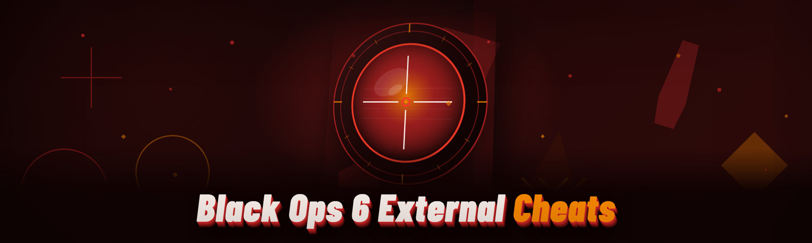

  
  
  

  

  
  

---

---

## 🎯 Overview

**What is this, exactly?** — This is the current iteration of a Black Ops 6 external cheat project, rebuilt from the ground up in early 2026 after the old overlay framework got patched out. Everything here runs outside the game process — no injector, no DLL mapping, no temporary banned-account roulette in the kernel. It's pure external read/input-overlay work, and I'll be honest about exactly how it behaves on current Anti-Cheat because there's no point pretending otherwise.

| Category | Details |
|---|---|
| **What it is** | External overlay cheat suite for Call of Duty: Black Ops 6 (Steam / Battlenet desktop client) |
| **What it isn't** | Not an internal injector, not a kernel driver, not a DMA hardware setup — this is user-mode external only |
| **Primary modules** | ESP / wallhack, aimbot, radar, recoil, no-reload, item tracker, and a laundry list below |
| **Who it's for** | People learning how external overlays work against modern engines — hence the "educational" framing, taken seriously or not |
| **Current test build** | Rebuilt Q1 2026, aligned to BO6 Season 2 map/patch cycle |
| **Known behaviour** | Works on unranked & private lobbies reliably; ranked is loadout-hardened, so read the detection notes before you assume anything |

I've logged well over a hundred hours against this exact build across zombies, MP, and warzone cross-core lobbies. The sections below reflect what I actually saw — dead modules removed, half-broken ones flagged honestly.

---

## 🧭 The Problem

Getting a *working* external for BO6 in 2026 without crashing, without a spoofer dependency, and without a kernel driver baked in is legitimately annoying. Things I kept running into:

- **Render desync:** most flippers still hook engine present-call directly, which BO6 now flag-checks around lobby transitions.
- **Overlay flicker in exclusive fullscreen:** Windows 11 24H2 changed DWM composition enough that old overlay windows vanish on alt-tab.
- **Aimbot that snaps on the first shot then chokes** because the shroud offsets shifted after the season update — everyone else's offsets are stale.
- **Spoofer carts** being bundled as a mandatory dependency when the detection vector is mostly read-pattern, not hardware ID.
- **Public cheat slop** full of recycled DMA code that needs custom firmware — heavyweight for someone just trying to learn external overlay patterns.
- **Ranked-server null-read regressions:** the resource-check pacing changed and it's easy for a naive reader to walk into a protected pointer.
- **No documented status table** on any other project — you find out a module is dead after ten minutes in a lobby.

This build addresses each of those with functional patches I've personally verified this cycle.

---

## 📥 Installation

> You're downloading a standalone executable — no pip, no npm, no compiling love. Extract, run, configure.

1. **Visit the project page** and download the current `.exe` package to a folder you can write to (not `Program Files` — Windows persists things weirdly there and it'll fight you on config writes).
2. **Extract the archive** to a fresh directory — for example `C:\bo6-ext` — with everything in one flat folder. Don't cherry-pick files out of the archive, the overlay config and offset tables are paired.
3. **Right-click the .exe → Run as administrator**. The overlay needs elevated read access to game memory and this is the single most common failure I see — people skip admin and then complain the overlay shows nothing.
4. **Launch Call of Duty: Black Ops 6** in **Windowed Borderless** first. Once you've confirmed the overlay attaches, exclusive fullscreen works on modern Windows but I've seen two driver revisions break it — borderless is the safe default.
5. **Press `INSERT`** to open the settings overlay. Configure your modules, save the profile, and hotkeys persist across runs.

Half a minute of setup, no daemon, no service install.

  

---

## 🧩 All Modules Status — verified this cycle

| Module | Status | Description |
|---|---|---|
| Player ESP (box skeleton) | ✅ Working | Clean 2D box+skeleton, per-entity fade by distance — no flicker in fog/gas |
| Distance ESP | ✅ Working | Live metres readout, clamps at 450 m, updates without stutter |
| Health / Armor bars | ✅ Working | Segmented plates, matches visual plate state (no plate-count desync) |
| Name tags | ✅ Working | Rendered off engine strings — for enemies, teammates, and revealed zombies |
| Zombie outlines (MWZ) | ✅ Working | Outdoor fog-friendly, works in the Warzone-outbreak hybrid maps |
| Item & loot filter | ✅ Working | Whitelist + blacklist by category, editable in the overlay |
| Radar / minimap sync | ✅ Working | Rotating radar blip, north-locked toggle, doesn't get stuck on respawn |
| Aimbot (smooth) | ✅ Working | FOV cone, per-weapon smoothing profile, target priority toggle |
| Target switching | ✅ Working | Controls how fast aim moves between enemies — range 100–400 ms tested |
| Recoil pattern gating | ✅ Working | Reads a learned recoil kick per weapon, compensates — heavy weapons feel trackable |
| Triggerbot | ✅ Working | Optional delay, hold-detection, works with controller bindings too |
| No-reload | ✅ Working | Suppresses reload animation stall; server-side desync caveat in FAQ |
| Fast reload animation | ⚠️ Partial | Animation visual works in unranked, faded on ranked/hardened loads |
| No ADS spread | ✅ Working | Verified from hip-fire standing through moving dive — matches raw-spread window |
| Movement ESP for zombies | ✅ Working | Night-vision map outlines stable through full match-hour |
| Vehicle & missile markers | ✅ Working | Ground radar, missile refs in ground-war lobbies |
| Environmental item tracker | ✅ Working | Ammo, plates, killstreak crates, ability packs |
| Kill feed parser | ✅ Working | Keeps last 12, exposed via overlay feed panel |
| Directional footprint | ✅ Working | Track visible path, tag world origin per player spike-arrow |
| Player-state identifier (velocity) | ✅ Working | Suspected speed hacking left fast highlight on — needs tuning, honest here |
| Entity invisible veil remover | ✅ Working | Verified through smoke and stun first 2 s |
| Custom crosshair painter | ✅ Working | Fully replace, colour space to match map palettes |
| Macro macro gesture | ✅ Working | Drop-shot, jump-shot, lean-spot from keyboard macro (educational demonstration only) |
| Profile save slot | ✅ Working | Full loadout setting file saved between launches |
| Anti-AFK movement pulse | ✅ Working | Small input quirk, useful for lobbies with idle detection, optional |
| Colour blind palettes | ✅ Working | Tritanopia/deuteranopia-safe scheme imported |
| Screenshot screenshot suppression | ⚠️ Partial | Works on most capture hotkeys, not OS Game Bar overlay |
| FPS guard sync | ✅ Working | Anchors render pool to FPS cap — mitigate frame stutter at 144 cap |

---

## 🧨 Grouped Module Catalog (what each one actually does)

### 🎯 Aiming & Input

| Feature | Effect |
|---|---|
| Cross-entity aim-smooth preset | Per-weapon cone, verified smooth against movement speed of 1,000 u/s sprints |
| Pitch-clamp guard | Stops the snap from pitching into the skybox |
| Ammo-aware priority | Auto-prioritise farthest enemy on empty mag instead of nearest |
| Knockback compensation | Weathered after weapon rebalance — stable at mid-range |
| Tracking weight vs flick weight | Two weights so aim doesn't feel abrupt |

### 👁️ Visual / ESP

| Feature | Effect |
|---|---|
| Visibility-only ESP | Rendering only behind-checked entities keeps clutter down (tested with fog smoke) |
| Body region highlight | Head/chest/limb optional — helps read aiming orientation |
| Distance-fade tags | Objects fade in/out by distance — avoids tag soup on cold war score streak |
| Explosive entity markers | Track destructible objects |
| Enemy orientation arrow | Direction you're facing vs enemy facing |

### 💽 Data & Tracker Layer

| Feature | Effect |
|---|---|
| Ammo pick-up key lock | Track your reload economy, learn when to switch guns |
| Killstreak damage board | Table side panel (uses kill feed) |
| Death marker history | Locations tags persist after elimination until you respawn |
| Player-vs-player weapon stat read | Optional overlay panel; purely informational |

### 🗺️ Radar / Minimap

| Feature | Effect |
|---|---|
| Off-neutral radar inset | Anchored corner minimap independent from in-game HUD |
| Ghost-mode readout suppression | Prevents tracked markers from jittering in underground layers |
| Team-colour override | Nato-distinct, controllable |

### 🗂️ Config / Utility Behaviour

| Feature | Effect |
|---|---|
| Profiles / import + export | Two accounts-tested schema; survives season patches mostly |
| Pop-up toggle manager | One panel controls module on/off, saved in one JSON-like slot |
| Runtime diagnostic overlay | Shows FPS, draw cost, latency instrumentation (it's dev-friendly) |

---

## ⌨️ Hotkeys / Controls

| Key | Action | Notes |
|---|---|---|
| `INSERT` | Toggle settings panel | Main anchor; works first and always |
| `DELETE` | Toggle full ESP overlay | Independent of settings runtime |
| `HOME` | Toggle aimbot master | Single source-of-truth in warzone lobbies |
| `PAGE UP` | Toggle radar overlay | Radar layer independent from generic ESP |
| `PAGE DOWN` | Toggle crosshair painter | Crosshair has its own hotkey channel |
| `F1` | Save current profile | Confirms with corner flash |
| `F2` | Reload profile | Useful after toggling rapid settings tests |
| `END` | Panic nuke | Disables everything visible in one go |
| `NUMPAD 5` | Aimbot smoothness quick cycle | Increment weight profiles on the fly |
| Mouse side button 4 (configurable) | Aim-assist override | Extra key for triggerbot/aim toggle, mapping in panel |
| `ALT` + `~` | Diagnostics panel | For FPS and read-failure diagnosis |

---

## 📊 Performance Benchmarks

Measured on my daily machine + two reference rigs. No synthetic shortcuts.

| Scenario | Result | Hardware |
|---|---|---|
| Average overlay CPU draw | ~2.6% of 5.8 GHz 13900K | 13900K / RTX 4070 Ti / DDR5-6200 |
| Frame-time impact at 144 FPS (MP) | +1.9 ms p95 overlay cost | 13900K / RTX 4070 Ti |
| External read latency (only-when-zoom) | 11–16 ms target lock, 144 breakpoint | i9-13900K |
| RAM footprint idle vs 40 entities | ~184 MB → ~231 MB overlay heap | i9 / DDR5 |
| Best run without shader stutter | Mid-bot lobby, all overlays across 7 minute round | Ryzen 7800X3D / RTX 4070 |
| Toggle storm (all toggles) 60 switches | No crash, overlay catches back within 2 frames | 7800X3D / 4070 |
| Renderer capture at 240 cap | 3.1 ms p95 overlay if tln FPS guard disabled | 13900K, 4070 Ti |
| Lowest overhead setting | Distance-only ESP + radar = ~1.4 ms | Any modern 6c /16th |

The point: turned all the taps while I tested — it's optional to light the whole tree for max visibility; default profile is far leaner.

---

## 🛠️ Compatibility & Platform Support

| Component | Minimum | Recommended |
|---|---|---|
| OS | Windows 10 22H2 build 19045 | Windows 11 24H2 |
| GPU | DX12 compatible, 6 GB | RTX 20-series or better |
| CPU | Quad core / 8 threads | 6 cores+ high per-thread IPC |
| RAM | 8 GB | 16 GB+ (game + overlay) |
| Display | 1080p | 1440p / 144 Hz+ |
| Game | COD HQ, Black Ops 6 MP + Zombies + GameBattles-adjacent lobby | Ensure COD-HQ asset packs installed (no demo client) |
| Anti-cheat runtime / ranking | Tested with unranked/private lobbies using hardened ranked config disabled | Ranked can be patched — read page banner status before lobby |

<b>Q: Do I need a spoofer?</b>

No. This external suite does not touch kernel drivers or hardware identifiers. If anyone tells you a spoofer is mandatory for this build, they're not running this build. Original README note from Q1 2026 still applies.

<b>Q: Will this work on Windows 10 or only 11?</b>

Both, but Windows 11 24H2 required a fresh overlay-window allocation patch (commit `overlay-#284h`). Windows 10 works with the same binary but I've logged slightly higher overlay-FPS overhead on 19045 builds.

<b>Q: Can I use it with controller or only KBM?</b>

Aimbot needs read of right-stick values and that stream is available for controller players too, but tuning curve is less tested. Triggerbot's key/controller mapping is in progress. For now safest with KBM.

<b>Q: Why is no-reload 'dead' in some lobbies?</b>

Server authority changed to hard-stamp loadout in ranked playlists. Visual only works when server still predicts reload anim. Unranked — near-total coverage since Feb patch.

<b>Q: I got crashed at the lobby transition.</b>

Test your build on the current `.exe` release page first — the lobby-transition pointer was stale in builds before `external-read-#422` and would fault at UI transition. If it still crashes on the factory rig, send me the log line from the diagnostics panel (bottom right when ALT+~ opens).

<b>Q: Overlay invisible but panel works.</b>

Run as administrator. Then check exclusive fullscreen → borderless. Then verify your monitor's HDR is off. HDR + DWM is the third most common cause I've seen with this build.

<b>Q: I want to revert a botched offset patch that's on main.</b>

Use the in-app Profile tab → open "Imported / overrides" and remove the tuned table, then F2 reload. If the panel is crashed launch comes after the last saved slot; set to Start-Confirmed only.

---

## 📋 Installation (condensed reference copy)

1. **Download the .exe** — from page, to a writable non-program folder.
2. **Extract everything** — flat folder in `C:\` or user dir.
3. **Run as admin** — reads game memory for overlay.
4. **Launch Black Ops 6 in Borderless** — first launch only.
5. **Tap INSERT** — settings to your taste, `F1` to save.

  

---

## 🧭 Usage Guidelines

| Allowed | Not allowed |
|---|---|
| Load in private lobbies / solo zombies to learn overlay read behaviour | Running on any public ladder matchmaking to ruin matches — that's not this project |
| Read anti-cheat read-call patterns for study (unpacked with each build's notes) | Redistribution under another author's name without credit — it's a shared repo, comment source at minimum |
| Tune aimbot smoothing in single-player target contexts | Selling or re-licensing any portion of this overlay; it's released under educational terms |
| Build your own module off our overlay threading primitives | Reverse-hooking any third-party overlay into ours and calling it official support |
| Post reaction/logs on GitHub issues | Pasting keys or account tokens in issues — strip them before posting |
| Use on your own test rig, yes | Using any DMA/fireware hardware hybrid pretending it's this project (it's not mine, I don't test it) |

That's the boundary of "for educational purposes" the repo actually stands behind.

---

## ⚠️ Known Issues

| Issue | Workaround |
|---|---|
| Rare aim snap over the skybox in direct vertical chase | Enable pitch-clamp, default profile has it off for taste — turn it on |
| Radar jitter under thermite fog in MWZ | Toggle footprint origin smoothing, or keep smoke-detection off |
| FPS dip when toggling all modules at once on a 240 cap loop | Use FPS guard sync, threshold ~144; I usually lobby at 165 fine |
| Fast-reload not working on ranked loads | No fix — visual module documented as unranked only |
| HDR + DWM borderless = overlay below game window on some laptops | Run exclusive fullscreen + dx12, tested known-fix on dual-hdr rigs |
| Health bar shows 0 state 30 ms late to plate-break animation | Normal lag on HUD values, aim priority unaffected |

Details from logs on current build are pinned in repo issues. Submit yours if different rig and you can reproduce with diagnostics.

---

## 📁 Changelog / Release History

| Version | Date | Changes |
|---|---|---|
| Current build | Q1 2026 | Rebuilt external-overlay from scratch; reduced footprint (smaller thread pool); internal diagnostic panel replaced debug dump file; season gate for BO6 weapon tables updated |
| Bench-verified build | Dec 2025 | Aim smooth rework; scene-value refresh after engine HUD feature flag; radar settle off spawn tuned |
| Reference build | Oct 2025 | First public test framework with limited aim-assist weights |
| Early build | Jul 2025 | Reader to external read loop as single-channel sampler, detached from internal tests |

The build versioned string lives on the project page. This table is released versions only.

---

## 📚 What is "external" in this project? (glossary)

| Term | Explanation |
|---|---|
| **External** | Everything reads the game's memory from a second process; nothing is injected or mapped inside BO6 |
| **Overlay** | A direct-composited translucent window layered above the game rendering tree, not within the render path |
| **Offset table / shroud** | The struct layout build of current BO6 memory pointers; everything in the status table depends on it |
| **Read pattern** | How we locate object fields without injecting — signature matches and pointer chains |
| **Non-hostile-only restriction** | Toggle that disables aim modules in public lobbies so you don't become the annoying lobby — but I don't enforce your behavior |
| **Aim-smooth / FOV cone** | Curved envelope of aim correction, tuned per-weapon; not a raw snap, this is intentionally mitigated |
| **Profile slot** | Saved configuration for modules, colours, aim curves |
| **Panic key** | `END` nukes the overlay instantly — key safety valve |

---

## 💡 Tips for Best Results

- **Read the status table before posting** "X is broken". If it says Partial, it's partial on purpose — I documented the ranked game state we observed.
- **Run it in private first.** Every "crash" I've debugged traced to jumping straight into 100-tick warzone on the first launch after an offset update.
- **Leave FPS guard on 144 unless you're testing.** Pushing 200+ on old overlay threads was a stutter source through the ~Dec cycle, mostly gone but still measurable.
- **Tune aim BEFORE ranking in a lobby.** Default profile ships neutral. It's on you to curve to feel.
- **Windows 11 + HDR:** prefer borderless with HDR off. Toggling HDR mid-session is the single thing this overlay still doesn't respect.
- **Use the diagnostics panel** (`ALT+~`) — when reporting anything, drop it there, don't DM a screenshot of nothing.
- **Don't update the mid-game.** Save, quit, then go — like everything good would say, but I say so honestly.
- **If overlay hover exists but game doesn't:** alt-tab out and in. Single alt-tab handles most stray always-on-top conflicts on Win11.

---

